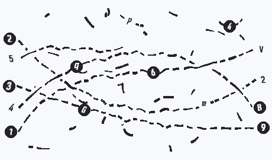
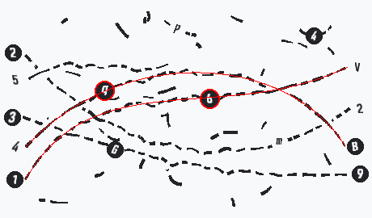

# bezcaptcha

`bezcaptcha` is a stateless-token, replay-protected path-tracing CAPTCHA library and Axum HTTP server written in Rust. It generates lossless WebP challenges (about 6 KiB for Medium hardness level) where users trace specific intertwined cubic Bézier wires from numbered left-hand ports (`1`..`6`), collect sequential Base32 waypoint characters along each wire, and identify the terminating right-hand letter port (`A`..`H`).  Generating one image (Medium hardness level) takes about 7 ms on Core i5-13600K.

---

## Visual & Geometric Algorithms

### 1. Randomized Non-Uniform Port Allocation, Decoy Left Ports & Dead-End Branches
Left and right port coordinates are generated via `random_port_coords`. Instead of placing ports on a fixed pixel grid, available vertical slack is distributed across random weights with an extra-wide slot injected at a random index, alongside horizontal X-jitter.
- **Full-Span Decoy Left Ports**: Decoy left ports (e.g., `5`..`8`) are rendered at the left edge ($x \approx 14$), vertically shuffled among valid ports (`1`..`4`), and emit full-span decoy wires traveling across the canvas into right-hand ports.
- **Mid-Canvas Dead-End Wires**: Left ports also emit unconnected dead-end wires that bifurcate from valid or decoy ports and terminate mid-canvas ($x \in [195, 345]$), preventing automated solvers from filtering real paths by endpoint $x$-coordinates.

### 2. True Arc-Length Resampled Cubic Bézier Curves
Each wire is defined by four control points $(P_0, P_1, P_2, P_3)$:
$$B(t) = (1-t)^3 P_0 + 3(1-t)^2 t P_1 + 3(1-t) t^2 P_2 + t^3 P_3, \quad t \in [0, 1]$$
Because standard parameter steps $\Delta t$ compress samples in high-curvature regions and stretch them on flat segments (leaking curvature information via dash lengths), `sample_bezier_by_arc_length` evaluates 2,000 fine steps along $B(t)$ and emits equidistant samples every $1.0\text{ px}$ of true Euclidean arc length $s$, along with analytical unit normal vectors:
$$\mathbf{n}(t) = \frac{(-B'_y(t), B'_x(t))}{\|B'(t)\|}$$

### 3. Multi-Frequency Harmonic Fourier Jitter
To defeat polynomial curve-fitting and parametric Ransac solvers while keeping curves smooth to the human eye, each wire is displaced along its unit normal vector $\mathbf{n}(s)$ by a 3-component Fourier series windowed by a $\sin^2$ envelope that pins both endpoints to zero displacement:
$$\Delta n(s) = \sin^2\left(\pi \frac{s}{L}\right) \sum_{k=1}^{3} A_k \sin(\omega_k s + \phi_k)$$
where $L$ is the total wire length, $A_k \in [1.0, 2.8]\text{ px}$, and $\omega_k$ correspond to incommensurate spatial wavelengths (~75 px, ~38 px, and ~22 px). After displacement, cumulative arc lengths and finite-difference unit normals are recomputed.

### 4. Rejection Sampling for Unambiguous Crossings
Before any wire (real, full-span decoy, or dead-end) is accepted into the scene, `check_coarse_clarity` tests it against all previously accepted wires across candidate generations:
- **Shallow Crossing Rejection**: At any close approach ($d < 7.5\text{ px}$), the cosine of the relative angle between wires is computed via their unit tangents ($|\mathbf{t}_1 \cdot \mathbf{t}_2| = |\cos \theta|$). Candidates with $|\cos \theta| > 0.86$ (crossing angle shallower than $\approx 30.6^\circ$) are rejected.
- **Parallel Corridor Rejection**: Candidates that remain within $10.5\text{ px}$ of an existing wire for $\ge 3$ coarse steps ($\approx 28\text{ px}$) of continuous arc length are rejected.

### 5. 3D Bridge Weaves & Angle-Attenuated Underpass Swerves
Wires are assigned a continuous 3D elevation wave $z_i(x) = \sin(0.038 x + 1.73 i)$. At every intersection:
- The upper wire ($z_i \ge z_j$) is locked to a solid stroke within a $9.0\text{ px}$ radius (`OVERPASS_SOLID_RADIUS`).
- The lower wire ($z_i < z_j$) is cut completely within a $6.5\text{ px}$ radius (`UNDERPASS_CUT_RADIUS`), creating a 3D over/under weave.
- To prevent simple tangent extrapolation across the underpass gap, `apply_underpass_swerves` injects a localized antisymmetric Gaussian-derivative dipole deflection:

$$\delta(s) = \pm A_{\text{max}} (1 - \cos^2 \theta) \left(\frac{\Delta s}{\sigma}\right) \exp\left(-\frac{\Delta s^2}{2\sigma^2}\right)$$
Scaling by $(1 - \cos^2 \theta)$ ensures that steeper crossings receive a subtle tangent deflection while shallower crossings are not shifted into neighboring paths.

### 6. Chirp-Modulated Dash Cadence, Dynamic Stroke Weights & Contrast-Inverted Distorted Glyphs
- **Chirp-Modulated Cadence**: Outside of overpass locks and badge halos, wires are rendered with an asymmetric dash-dot-dash cadence (period $34\text{ px}$) warped by a spatial frequency chirp:
$$s_{\text{warped}} = s + 9.5 \sin(0.021 s + 0.18 \phi_0)$$
- **Dynamic Stroke Weight Modulation**: Instead of drawing fixed-width segments, `StrokeModulation` continuously varies wire and micro-stroke radii $r(s) \in [0.45, 1.85]\text{ px}$ along the local normal vector $\mathbf{n}(s)$.
- **Contrast Inversion & Affine Glyph Distortion**: Waypoint and port glyphs randomly invert contrast polarity (dark filled halo with light glyph vs. light halo with dark glyph) and undergo continuous scale jitter, affine shearing ($\pm 15^\circ$), and rotation ($\pm 25^\circ$) along the local wire tangent vector $\mathbf{t}(s)$ via inverse-mapped bilinear resampling.

---

## Cryptographic MAC & Replay Protection Architecture

`bezcaptcha` requires zero server-side storage at challenge issuance time and protects verification state against memory-exhaustion Denial-of-Service (DoS) attacks using a dual-MAC scheme built on **SHAKE256** (FIPS 202 extendable-output function).

### Token Format
```
<nonce_hex_32>:<expires_at_unix>:<issue_mac_hex_64>:<answer_mac_hex_64>
```

- `nonce`: 128-bit (16-byte) cryptographically random value encoded as 32 hex chars.
- `expires_at_unix`: Challenge expiration timestamp (`now + 120` seconds).
- `issue_mac`: 256-bit (32-byte) SHAKE256 tag over `nonce:expires_at_unix` with domain `"issue"`.
- `answer_mac`: 256-bit (32-byte) SHAKE256 tag over `nonce:expires_at_unix:NORMALIZED_ANSWER` with domain `"answer"`.

### Length-Prefixed Domain-Separated SHAKE256 Construction
Both MACs are computed by `compute_shake256_mac`:
```
SHAKE256(
0x01 || "captcha" ||
BE64(len(domain)) || domain ||
BE64(len(secret)) || secret ||
hardness_tag (0x00 | 0x01 | 0x02) ||
payload
) -> 32 bytes
```

All MAC comparisons use constant-time equality (`subtle::ConstantTimeEq::ct_eq`) to prevent timing side-channels, and verification parses tokens into fixed-size stack buffers with zero heap allocations.

### Two-Stage Verification & DoS Prevention
1. **Stateless Issuance Verification (`issue_mac`)**: Before acquiring any mutex lock or inserting into `AttemptStore`, `verify_captcha_token_with_hardness` verifies `issue_mac` in constant time. Forged tokens with random nonces are rejected immediately without touching memory.
2. **Rate-Limited Attempt Tracking (`AttemptStore`)**: Once `issue_mac` is proven authentic, `AttemptStore` tracks failed guesses per nonce (up to `DEFAULT_MAX_FAILED_ATTEMPTS = 5`, rate-limited to 1 attempt every `3` seconds) and prunes expired entries every 30 seconds.
3. **Generational Replay Protection (`SpentNonceStore`)**: Upon a valid `answer_mac`, the 16-byte nonce is inserted into a 3-bucket generational ring buffer (`BUCKET_DURATION_SECS = 60`, covering the 120-second TTL window) with $O(1)$ bucket rotation and a hard cap of `200,000` nonces (~5 MB peak RAM).

---

## Running the Server & Example `curl` Usage

### 1. Start the Server

Default hardness (hard), or pass easy / medium / hard as CLI arg or `CAPTCHA_HARDNESS` env var
```bash
cargo run --release --bin bezcaptcha -- hard
```
The server listens on `http://127.0.0.1:3000`.

### 2. Fetch a Challenge (`GET /api/captcha/challenge`)
Request a challenge (optionally overriding difficulty via `?hardness=easy|medium|hard`):
```bash
curl -s "http://127.0.0.1:3000/api/captcha/challenge?hardness=easy" | jq .
```
Example JSON response:
```json
{
"prompt": "Trace wires 1 and 3: enter each wire's waypoint digit followed by its end letter (4 chars, e.g. 7B4E, base32 chars "0123456789bcdefghjkmnpqrstuvwxyz")",
"image_data_url": "data:image/webp;base64,UklGR...",
"token": "9f8e7d6c5b4a39281726354455667788:1793000120:4a1b...64_hex_chars...:8c9d...64_hex_chars...",
"expires_in_secs": 120
}
```

To save and view the WebP image directly from the command line:
```bash
RESP=$(curl -s "http://127.0.0.1:3000/api/captcha/challenge")
echo "RESP"∣jq−r′.prompt′TOKEN=(echo "$RESP" | jq -r '.token')
echo "$RESP" | jq -r '.image_data_url' | sed 's/^data:image/webp;base64,//' | base64 -d > captcha.webp
```

### 3. Verify an Answer (`POST /api/captcha/verify`)
Submit the `token` and traced `answer` (case-insensitive):

```bash
curl -s -X POST "http://127.0.0.1:3000/api/captcha/verify" -H "Content-Type: application/json" -d "{"token": "$TOKEN", "answer": "735B492E"}" | jq .
```

Example responses:
- **Correct answer (`200 OK`)**:
```json
{
"valid": true,
"reason": "Verified"
}
```

- **Wrong answer (`400 Bad Request`)**:

```json
{
"valid": false,
"reason": "Incorrect answer"
}
```

- **Replayed token (`400 Bad Request`)**:

```json
{
"valid": false,
"reason": "Token already used"
}
```

## Testing the Python solver
Run the debug version:
```bash
./target/release/main_debug &
```
Attempt solving it:
```
python assets/solver.py
--- Single Attempt Execution ---
Prompt           : Trace wires 3 and 4: enter each wire's 3 characters from left to right followed by its right-end character (8 chars, e.g. 735B492e, base32 chars "0123456789BCdeFGhJKmnPqrStuVWXyZ", the answer can be in either upper- or lowercase)
Predicted Answer : eer02KWm (Length: 8)
Server Truth     : ZXKG2WCm (Ignored by solver)
HTTP Status      : 400
Server Response  : {'valid': False, 'reason': 'Incorrect answer'}
RESULT: FAILED - Incorrect answer or rejected by server.
```

Note that in production version the web client cannot change `hardness` level, it is baked into `compute_shake256_mac` and `"/api/captcha/challenge"` → `ui::get_captcha_challenge_json` does not take any query parameters but strictly fetches the current `hardness` setting from the PostgreSQL database.

## Reporting bugs
Bugs are the following ones:

- solver.py solves the captcha: send a fix for `src/captcha.rs` without making captcha harder for humans to solve.
- Rust code crashes: send a fix.
- solver.py does not solve the captca: send a fix for `solver.py` but not for `src/captcha.rs`.

## Licensing & Commercial Use

This software is licensed under the GNU Affero General Public License v3.0 (AGPL-3.0).
Static or dynamic linkage in SaaS backends requires source disclosure under Section 13.

- **Commercial / SaaS License:** If you require proprietary integration without AGPL-3.0 copyleft obligations, contact me for a commercial license.
- **Contributions:** All contributions are subject to the terms set forth in [CONTRIBUTING.md](CONTRIBUTING.md).

## Font generation

```bash
$ sudo dnf install python3-fonttools
$ pyftsubset /usr/share/fonts/misc/Iosevka/IosevkaTerm-Bold.ttf \
  --text="0123456789ABCDEFGHIJKLMNOPQRSTUVWXYZabcdefghijklmnopqrstuvwxyz" \
  --output-file=minimal.ttf --no-hinting --desubroutinize --layout-features="" --drop-tables="name,post,OS/2"
```

## Screenshots


